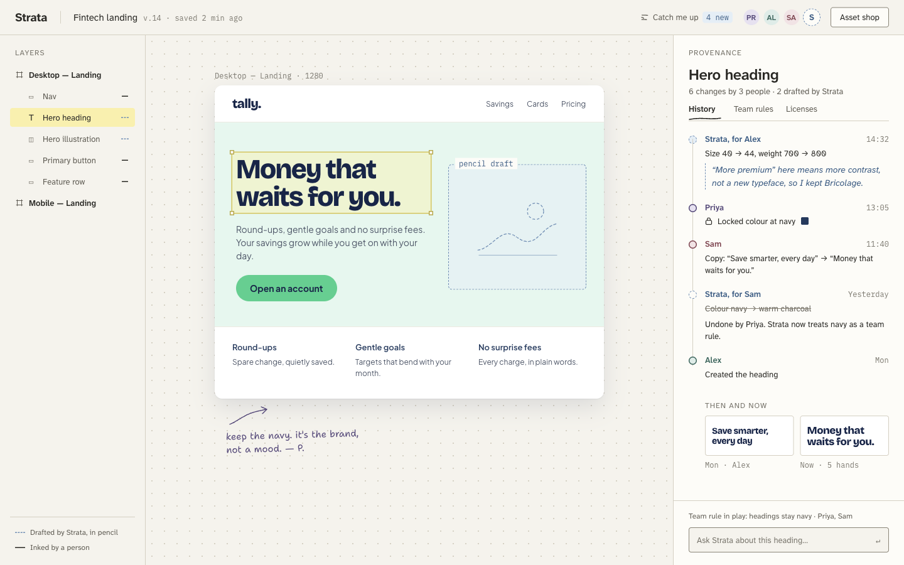

# Strata

**Every element knows who made it, why, and whether you're allowed to ship it.**

Strata is a shared design workspace for small product teams, with one AI teammate that lives in the file.
It remembers who decided what and why, learns the team's taste from what people keep and undo, refuses to
silently override a teammate, and lets the team try and buy design assets directly on their own design,
inside a spending limit, with every licence tied to the elements that use it.

Built for LA Hacks AI Hackathon 2026 · Visa "The Future of Shopping" · Paper "Best Designed Hack" ·
CREAO "AI-First Disruptor" · main track: Applied Intelligence. Devpost text: [`SUBMISSION.md`](SUBMISSION.md).



## What's in this repo

| Path | What |
| --- | --- |
| `design/screens/` | The UI designed by hand in Paper: design system and six product screens |
| `design/tokens.css` | Design tokens exported from Paper ("drafting table" system) |
| `design/assets/` | Original illustrations and icon sets sold in the demo catalog (drawn by us) |
| `base44/BASE44_BRIEF.md` | Prompts for a later Base44 version (not part of this submission) |
| `base44/entities/` | Entity schemas for the later Base44 version |
| `demo/` | The working app: workspace, Provenance Lens, AI teammate, Try-on Shop, checkout, licences (FastAPI + one page) |
| `base44/CREAO_BRIEF.md` | The three CREAO agents (Curator, Teammate, Catch-up): specs, setup, wiring |
| `base44/functions/` | Base44 functions for the later version (CREAO runs, webhook, agent API) |
| `scripts/run_creao.py` | Start a CREAO agent run from the command line |
| `docs/Strata_Project_Brief.pdf` | Project brief: problem, features, method |
| `strata_agents/` | Prototype: multi-agent ASI:One shopping flow (Fetch.ai uAgents + LangGraph). Not part of this submission |

## The idea in one screen each

| Screen | What it shows |
| --- | --- |
| Provenance Lens | Click any element: who changed it, human or AI, on whose request, and the AI's stated reason |
| Conflict card | The AI won't undo a teammate's locked choice; it names both people and asks |
| Try-on Shop | Assets ranked by the team's learned taste, previewed on the real design, watermarked |
| Review and pay | Licence choice, the buyer's spending limit, intent → cart → payment → receipt trail |
| Licences and export guard | Each licence tied to its elements; personal-use assets flagged before client export |
| Team rules | What Strata learned, who taught it, team vs personal vs split |

## Run it

```bash
uv sync
uv run python demo/server.py      # → http://localhost:8044
```

Put the CREAO agent IDs and API keys in `.env` (see `.env.example`). Payment is a **simulated Visa
authorization** (Visa offered no sandbox for the hackathon and asked teams to simulate): the team card is
tokenized, the agents never see it, and every purchase leaves an intent → cart → payment → receipt trail.

## CREAO agents

The AI in Strata is three CREAO agents. The app holds the UI, data and payments; for every AI step it sends
the agent the context (team rules, history, catalog, spending limit) through CREAO's API trigger, and applies
the agent's JSON reply: a ranked shortlist, an edit with its reason, a conflict card, or a catch-up.

| Agent | Agent ID | What it does |
| --- | --- | --- |
| Strata Curator | `<agent id>` | Ranks the catalog against the team's learned taste, licence and spending limit; writes the shop shortlist |
| Strata Teammate | `<agent id>` | Edits one element, records its reason in the element's history, opens a conflict instead of undoing a locked choice |
| Strata Catch-up | `<agent id>` | Summarises what teammates and the AI changed since you last looked |

Example agent run: `<share link>`

Remove the agents and Strata stops working: the shop has no shortlist, the AI can't edit or explain, and
nobody gets caught up.

```
Strata UI → server → CREAO API trigger {request, context_json} → agent run → JSON reply → applied → live UI
```

## Design language

The AI drafts in **dashed blue pencil**; people **ink** in solid. Calm vellum surfaces, hairline rules, no
shadows or glow, Atkinson Hyperlegible Next for legibility. The sample client site ("tally.") has its own
brand so it never blurs with Strata's UI. Research basis: calm technology (Weiser & Brown), smallest effective
difference (Tufte), low-saturation colour (Valdez & Mehrabian), and sketchy drafts inviting critique
(Wong; Schumann; Tohidi).

## Payments

Simulated Visa authorization on the team's tokenized card (Visa ending 4242). Nothing real is charged.

## Prototype agents (not submitted)

`strata_agents/` contains a five-agent version of the shopping flow for ASI:One (Concierge, Curator,
Renderer, Checkout, Ledger) orchestrated with LangGraph. To try it locally:

```bash
uv sync && cp .env.example .env
uv run pytest -q
```
